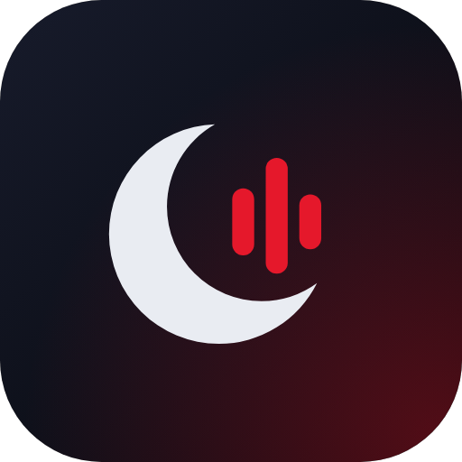
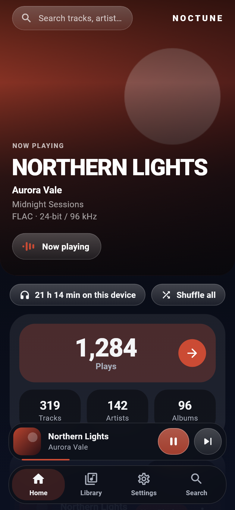
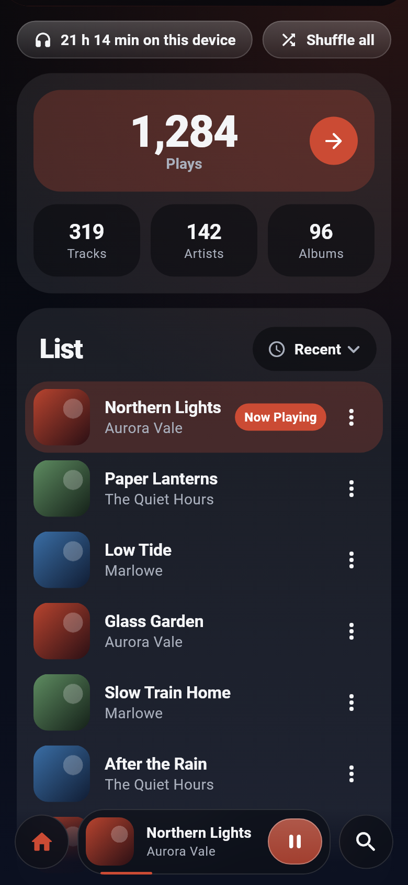
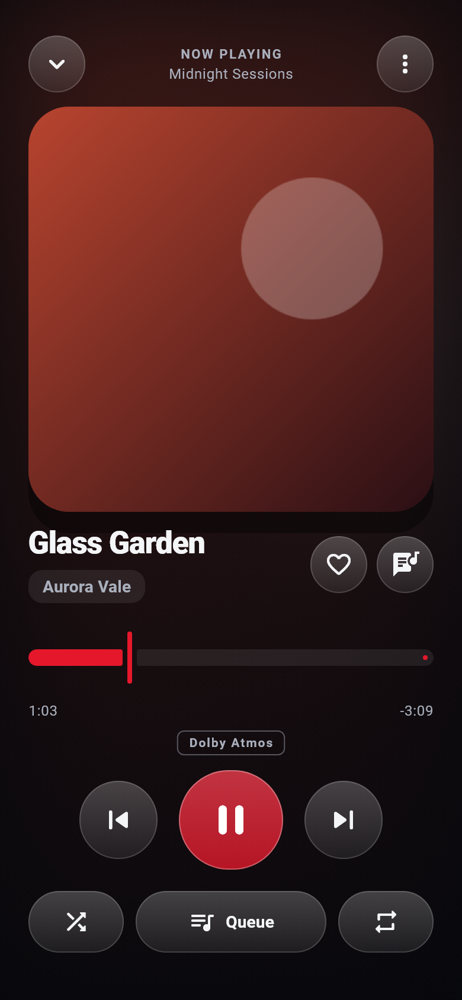
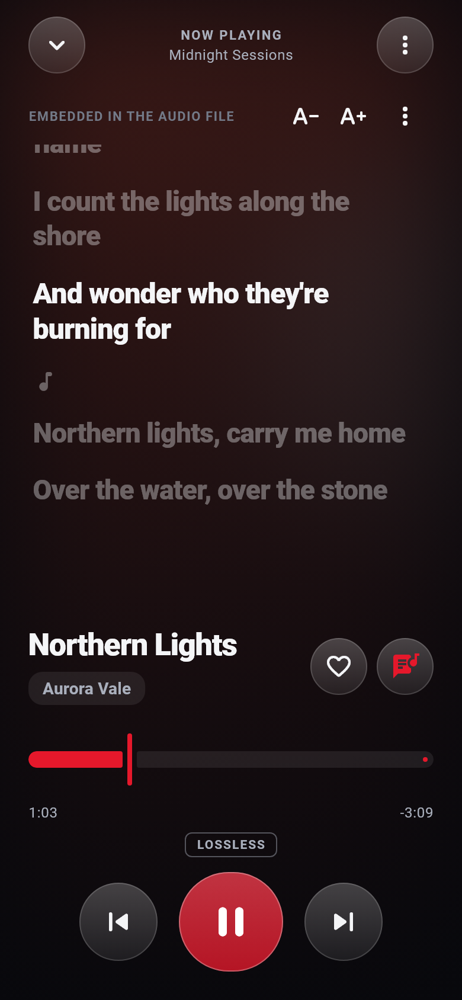

# NocTune

An offline music player for Android and iOS, built with Flutter. It plays the
music stored on the device, needs no account, and uploads nothing.

Builds are published on the [Releases](../../releases) page, and changes
are listed in the [changelog](CHANGELOG.md).

## Screenshots

| Home | Scrolling | Player | Lyrics |
|---|---|---|---|
|  |  |  |  |

Shown with sample tracks.

## Running it

```powershell
flutter pub get
flutter run                 # debug, on a connected device
flutter build apk --profile # for measuring real performance
flutter test
flutter analyze
```

Android compiles against SDK 37. Kotlin incremental compilation is turned off
in `android/gradle.properties` because the project and the pub cache may sit
on different Windows drives.

## Update checks

Update checks are **off by default**. A build made without the setting below
never contacts the network.

To turn them on, pass an HTTPS address when building. The published builds
use this repository's own releases, so a new GitHub release is all it takes
to announce an update:

```powershell
flutter build apk --release --dart-define=NOCTUNE_UPDATE_MANIFEST=https://api.github.com/repos/nischalsir/NocTune/releases/latest
```

With a GitHub address the release tag (`v1.2.0`) is the version, the release
page is where "Update now" goes, and bulleted lines in the release text are
shown under "What's new".

Alternatively the address can point at a small JSON file of your own, which
also allows required updates:

```json
{
  "version": "1.2.0",
  "build": 12,
  "url": "https://example.com/noctune/releases/1.2.0",
  "androidUrl": "https://play.google.com/store/apps/details?id=com.nischalpandey.noctune",
  "iosUrl": "https://apps.apple.com/app/id0000000000",
  "notes": ["Synchronised lyrics", "Faster scanning"],
  "minSupported": "1.0.0",
  "mandatory": false
}
```

| Field | Required | Meaning |
|---|---|---|
| `version` | yes | Newest version, as `major.minor.patch`. |
| `build` | no | Build number, compared when versions are equal. |
| `url` | yes | HTTPS page to get the release from. The app only opens it. |
| `androidUrl`, `iosUrl` | no | Per-platform page, used instead of `url`. On iOS this should be the App Store listing. |
| `notes` | no | Up to five short lines shown under "What's new". |
| `minSupported` | no | Versions older than this must update. |
| `mandatory` | no | `true` makes this update required for everyone. |

How the app uses it:

- It checks after the first screen is up, at most once every 12 hours, and
  falls back to the last good copy when offline.
- A file that is malformed, or whose links are not HTTPS, is ignored.
- "Later" silences that version for three days. "Don't remind me" silences it
  for good; a newer version is still announced.
- A required update shows only "Update now" and cannot be dismissed.
- The app never downloads or installs anything itself.

The logic lives in `lib/features/startup/update_service.dart`. Bump the app's
own version in `pubspec.yaml` (`version: 1.2.0+12`) for each release.

## Making a release

1. Bump `version:` in `pubspec.yaml`.
2. Build the APKs. Release signing reads `android/key.properties`, which is
   not in the repository; it names the keystore, its passwords and the key
   alias. Without it, release builds are signed with the debug key.
3. Create a GitHub release tagged `v<version>` and attach the APKs. Publishing
   it starts the `iOS build` workflow, which attaches an unsigned IPA.

The app icon is drawn by `tool/generate_app_icon.dart`; rerun it with
`flutter test tool/generate_app_icon.dart` after changing the design.

## Project layout

```
lib/
  app/        app shell, navigation, providers
  core/       theme, layout and shared widgets
  data/       database, models, repository
  features/
    home/     dashboard
    library/  browsing, playlists, device scan
    playback/ audio engine, mini-player, full player, queue
    search/
    settings/
    startup/  welcome and update popups
android/app/src/main/kotlin/…  MediaStore and artwork channels
```

## Previewing screens

To look at the main screens without a device, render them to PNG files with
sample data:

```powershell
flutter test tool/preview_screens.dart --dart-define=OUT=C:\some\folder
```

## Format labels and lyrics

- **LOSSLESS** is shown only when the file's contents confirm a lossless
  format: the FLAC stream marker, Apple Lossless inside an MP4 container, or
  uncompressed PCM in a WAV header. An extension alone is never enough.
- **Dolby Atmos** is shown only when the file is flagged as Atmos (Dolby
  Digital Plus with the JOC extension) *and* the device reports a decoder for
  that format. There is no Atmos switch, and nothing is labelled Atmos on iOS,
  where the app cannot check.
- **Lyrics** come from the device only: a file you import for a track, an
  `.lrc` file beside it, or lyrics embedded in its tags. Time-synced lyrics
  follow playback; plain lyrics are shown as text.

## Developed by Nischal Pandey

- Instagram: [@nischal_sir](https://www.instagram.com/nischal_sir)
- Email: [nischalpandey.dev@gmail.com](mailto:nischalpandey.dev@gmail.com)
